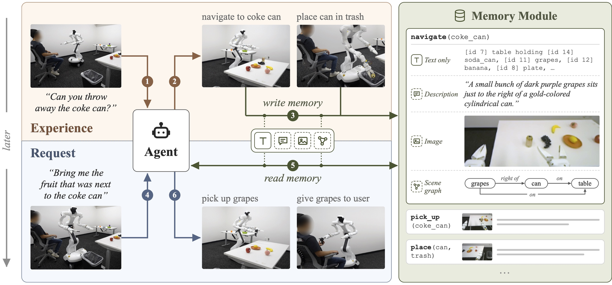
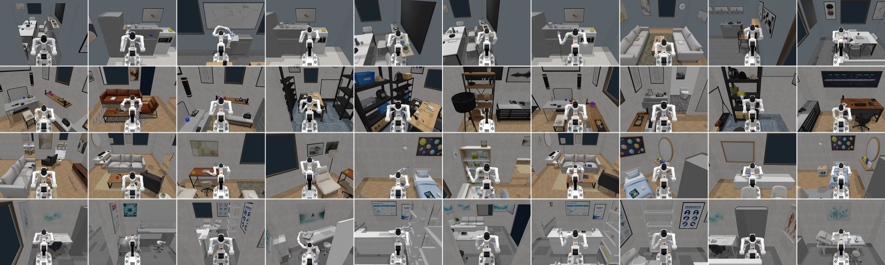

<div align="center">

# What Should Embodied Agents Remember?
### Benchmarking and Evaluating Memory Modality for Embodied Agents

[Junxiang Wang](https://jimwang418.github.io/)<sup>1,2†</sup>,
[Yuchen Liu](https://www.linkedin.com/in/yuchen-liu-40a84b180)<sup>1,3†</sup>,
Yi Wu<sup>1</sup>,
[Guofei Chen](https://gfchen01.cc/)<sup>1</sup>,
[Nir Pechuk](https://github.com/nirpechuk)<sup>2</sup>,
<br>[Tao Chen](https://taochenshh.github.io/)<sup>1</sup>,
[Zackory Erickson](https://zackory.com/)<sup>2</sup>,
[Yuzhe Qin](https://yzqin.github.io/)<sup>1</sup>,
[Tianyu Li](https://easypapersniper.github.io/)<sup>1</sup>

<sup>1</sup>Dexmate &nbsp; <sup>2</sup>Carnegie Mellon University &nbsp; <sup>3</sup>Purdue University
<br><sup>†</sup>Work done during an internship at Dexmate

[](https://arxiv.org/abs/2610.12561)
[](https://memoreval.github.io/)
[](https://huggingface.co/datasets/jimwang418/MeMoREval-scenes)
[](LICENSE)




</div>

**MeMoREval** is a benchmark for studying which ***Me****mory* ***Mo****dality* an embodied agent should use to remember what it sees, with a total of 53 robotics tasks. It measures task success together with the write-time and read-time inference costs of building and using memory.


## Release status

The benchmark code, including simulation, skills, memory backends, agent, and grading, will be released after peer review. Currently we release our design tasks, scenes, and robot asset.

### Tasks
[`tasks/`](tasks/) contains specifications of the tasks we designed for MeMoREval, as one JSON file per task with its experience, its requests, reference answers and success predicates.



### Scenes

Tasks are implemented in four environments adapted from [SceneSmith](https://github.com/nepfaff/scenesmith) scenes.
They include simulator-ready meshes, articulated furniture, and navigation maps for the robot.
The scenes are hosted on [Hugging Face](https://huggingface.co/datasets/jimwang418/MeMoREval-scenes).

```bash
hf download jimwang418/MeMoREval-scenes --repo-type dataset --local-dir data/scenes
```

### Robot

The simulated Dexmate Vega 1 robot is in [`robots/`](robots/) as an MJCF model.

## Citation

```bibtex
@misc{wang2026memoreval,
  title         = {What Should Embodied Agents Remember? Benchmarking and Evaluating Memory Modality for Embodied Agents},
  author        = {Wang, Junxiang and Liu, Yuchen and Wu, Yi and Chen, Guofei and Pechuk, Nir and Chen, Tao and Erickson, Zackory and Qin, Yuzhe and Li, Tianyu},
  year          = {2026},
  eprint        = {2610.12561},
  archivePrefix = {arXiv},
  primaryClass  = {cs.RO},
  url           = {https://arxiv.org/abs/2610.12561}
}
```

## License

This repository is released under the [Apache License 2.0](LICENSE).
See [NOTICE](NOTICE) for third-party attributions.

## Contact

Open an issue, or email Junxiang Wang (junxiang@cmu.edu) or Tianyu Li (ty.li@dexmate.ai).
